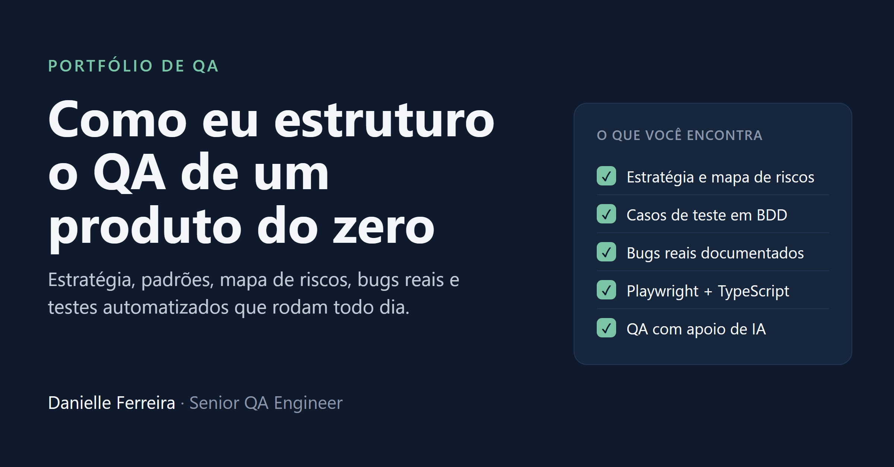
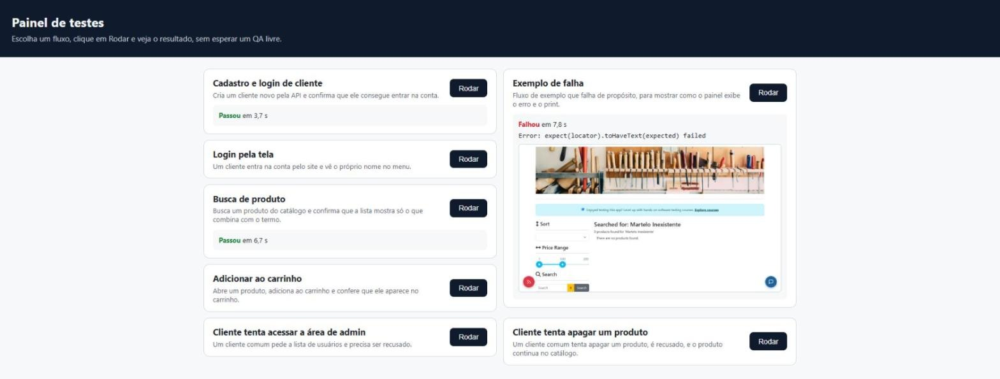

# QA Portfolio — Danielle Ferreira



[Versão em português](README.md)

I am a Senior QA Engineer with more than 6 years in software quality. What I enjoy most is organizing quality for a product and leaving a process the team can follow without depending on me. [LinkedIn](https://www.linkedin.com/in/danielle-ferreira-qa)

## What this repository shows

I took [Practice Software Testing](https://practicesoftwaretesting.com), a public demo tool shop, and treated it as the product of my team. This is the QA base I would build for it in the first weeks.

| Where | What you will find |
|---|---|
| [How this is organized](docs/en/how-this-is-organized.md) | The convention behind everything else. Start here |
| [Standards](docs/en/standards/) | How bugs, BDD test cases and QA results are written |
| [Test strategy](docs/en/strategy/test-strategy.md) | Scope, test levels, what I automate and what I do not, and how a release decision is made |
| [Risk map](docs/en/strategy/risk-map.md) | Where testing effort goes and why |
| [Areas](docs/en/areas/) | One doc per product area with rules, risks, BDD cases and a What to validate table linked to the tests |
| [Release report](docs/en/releases/release-report-example.md) | A go/no-go report in the format I use |
| [Bugs](docs/en/bugs/) | Real defects I found while exploring the shop |
| [AI-assisted QA](ai-assisted-qa/README.en.md) | A skill that turns a user story into BDD cases, with what the AI produced and what I corrected, and a guide on how I test AI and MCP features |
| [Test panel](panel/README.en.md) | A local panel where anyone on the team picks a business flow, clicks Run and sees whether it passed, without waiting for a QA to be free |
| [Tests](tests/) | Playwright + TypeScript. API checks for auth, catalog, cart and permissions, plus a small UI smoke |

## Test panel

Anyone on the team picks a business flow, clicks Run and sees the result, without waiting for a QA to be free. When a flow fails, the panel shows the error message and a screenshot of the moment it failed. In the image below, two flows passed and an example flow failed on purpose to show that screen. The panel itself is in Portuguese.



[How the panel works and how to run it](panel/README.en.md)

## Daily run

Every morning GitHub Actions starts a private copy of the shop in Docker, with freshly loaded demo data, and runs the whole suite against it, UI tests included. If the copy does not start, the run is reported as "Environment unavailable" instead of failing.

Before this, only the API tests ran on GitHub, because the public shop shows Cloudflare's bot check to traffic from servers, and I do not work around that kind of protection. With a private copy, the run no longer depends on the public site. The copy uses the shop's official images at a fixed version and exists only while the run lasts, never exposed.

**[See today's status and full report](https://danifferreira.github.io/qa-portfolio/)**

GitHub pauses scheduled workflows in repositories with no activity for 60 days. The page shows the date of the last run, so it is clear when that happens.

## Run it locally

```bash
npm ci
npx playwright install chromium
npm test
```

Tests that need an account register a new customer on every run. Tests that need a product pick one from the live catalog at run time, never by a fixed name or price.

By default the tests use the public shop. With Docker installed you can run them against the private copy, like CI does, with `bash scripts/start-local-shop.sh` and then `WEB_URL=http://localhost:4200 API_URL=http://localhost:8091 npm test`.

---

Structured and reviewed by me, with AI assistance (Claude Code).
