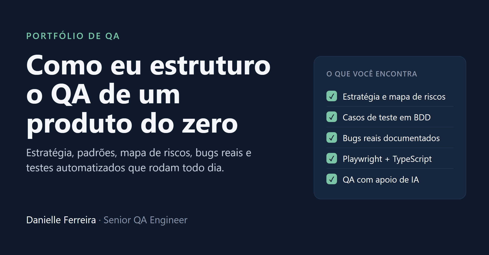
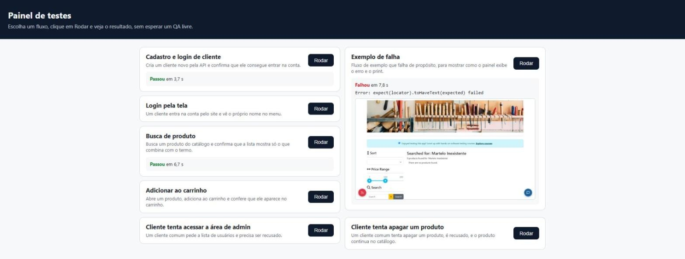

# Portfólio de QA — Danielle Ferreira



[English version](README.en.md)

Sou QA Sênior, com mais de 6 anos em qualidade de software. O que mais gosto é de organizar a qualidade de um produto e deixar um processo que o time consegue seguir sem depender de mim. [LinkedIn](https://www.linkedin.com/in/danielle-ferreira-qa)

## O que este repositório mostra

Peguei o [Practice Software Testing](https://practicesoftwaretesting.com), uma loja de ferramentas pública feita para treinar QA, e tratei como se fosse o produto do meu time. Esta é a base de QA que eu montaria nas primeiras semanas.

| Onde | O que você encontra |
|---|---|
| [Como esta base é organizada](docs/como-esta-base-e-organizada.md) | A convenção por trás de tudo. Comece por aqui |
| [Padrões](docs/padroes/) | Como escrevo bugs, casos de teste em BDD e resultados de QA |
| [Estratégia de testes](docs/estrategia/estrategia-de-testes.md) | Escopo, níveis de teste, o que automatizo e o que não, e como sai a decisão de release |
| [Mapa de riscos](docs/estrategia/mapa-de-riscos.md) | Onde vai o esforço de teste e por quê |
| [Áreas](docs/areas/) | Um documento por área do produto, com regras, riscos, casos BDD e a tabela "O que validar" ligada aos testes |
| [Relatório de release](docs/releases/relatorio-de-release-exemplo.md) | Um relatório de go/no-go no formato que eu uso |
| [Bugs](docs/bugs/) | Defeitos reais que encontrei explorando a loja |
| [QA com apoio de IA](ai-assisted-qa/) | Uma skill que transforma história de usuário em casos BDD, com o que a IA gerou e o que eu corrigi, e um guia de como testo funcionalidades com IA e MCP |
| [Painel de testes](panel/) | Um painel local em que qualquer pessoa do time escolhe um fluxo de negócio, clica em Rodar e vê se passou, sem esperar um QA livre |
| [Testes](tests/) | Playwright + TypeScript. Testes de API de login, catálogo, carrinho e permissões, mais um smoke de tela enxuto |

## Painel de testes

Qualquer pessoa do time escolhe um fluxo de negócio, clica em Rodar e vê o resultado, sem esperar um QA livre. Quando um fluxo falha, o painel mostra a mensagem de erro e o print do momento da falha. No print abaixo, dois fluxos passaram e um fluxo de exemplo falhou de propósito, para mostrar essa tela.



[Como o painel funciona e como rodar](panel/)

## Execução diária

Toda manhã o GitHub Actions sobe uma cópia própria da loja em Docker, com dados de demonstração recém-carregados, e roda a suíte inteira nela, testes de tela incluídos. Se a cópia não subir, a execução aparece como "Environment unavailable" em vez de falha.

Antes eu rodava só a API no GitHub, porque a loja pública mostra a verificação anti-robô do Cloudflare quando o acesso vem de servidores, e eu não contorno esse tipo de proteção. Com a cópia própria, a rotina não depende mais do site público. A cópia usa as imagens oficiais da loja, numa versão fixa, e existe só durante a execução, sem ficar exposta.

**[Ver o status de hoje e o relatório completo](https://danifferreira.github.io/qa-portfolio/)**

O GitHub pausa rotinas agendadas em repositórios sem atividade por 60 dias. A página mostra a data da última execução, então fica claro quando isso acontecer.

## Rodar localmente

```bash
npm ci
npx playwright install chromium
npm test
```

Os testes que precisam de uma conta cadastram um cliente novo a cada execução. Os que precisam de um produto escolhem um do catálogo real na hora, nunca por nome ou preço fixo.

Por padrão os testes usam a loja pública. Quem tem Docker pode rodar contra a cópia própria, como no CI, com `bash scripts/start-local-shop.sh` e depois `WEB_URL=http://localhost:4200 API_URL=http://localhost:8091 npm test`.

---

Estruturado e revisado por mim, com apoio de IA (Claude Code).
