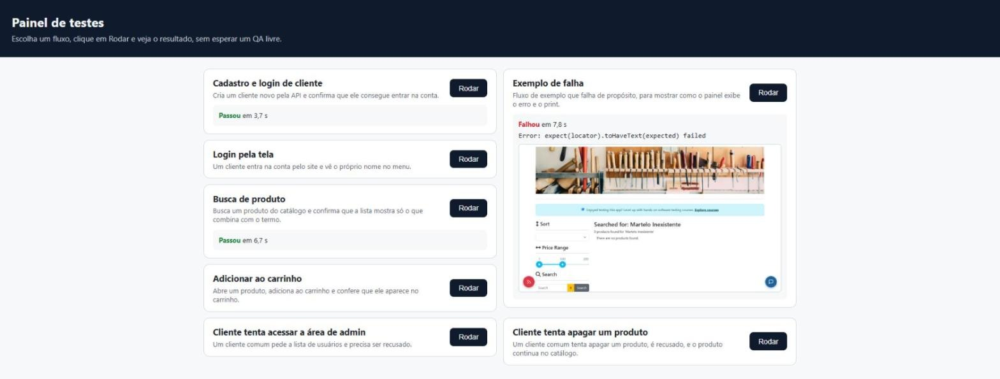

# On-demand test panel

[Versão em português](README.md)



*The "Exemplo de falha" flow in the image was created only for the screenshot and fails on purpose. It is not part of the flow list.*

A panel where anyone on the team picks a business flow, clicks Run and sees the result right away, without knowing how to code and without waiting for a QA to be free. The panel itself is in Portuguese, the main language of this portfolio.

## Why it exists

In a previous project, business analysts and the support team needed to see flows working all the time, such as onboarding a merchant. Every time they wanted that, they depended on a free QA, and the QA was almost always in the middle of something else. I built a panel where they picked the flow themselves, the automation ran and returned the result. This is the same idea, rebuilt from scratch on top of the demo shop.

The idea behind it is that automation does not have to serve only QA. When anyone can run a critical flow on their own, QA gets out of the way and the team gains autonomy.

## How to run it

```bash
npm ci
npx playwright install chromium
npm run panel
```

Then open http://localhost:4321 in the browser.

## What you see

Each flow has a business name, one sentence about what it checks and a Run button. While it runs, the screen shows "Rodando…". At the end it shows whether it passed or failed, how long it took and, when it fails, the error message and a screenshot of the moment it failed.

## How to add a flow

Each flow points to a test that already exists in the suite. To add one, add an entry to [flows.json](flows.json) with an id, the name the team will see, a short description, the test file, the Playwright project and the exact test title.

## Safety choices

The panel only accepts connections from the same computer, because it was not built to be exposed on a network.

It only runs the flows in the list. Nobody can type a command or a test filter through the screen.

It runs one flow at a time. If someone clicks while another flow runs, they get a message to wait.

The failure screenshot is only served when it is inside the test results folder.

## Tests for the panel itself

The panel has its own tests, run with `npm run panel:test`. They cover reading the Playwright result, the flow list, an unknown flow, a duplicate request, a timeout and the screenshot protection.
