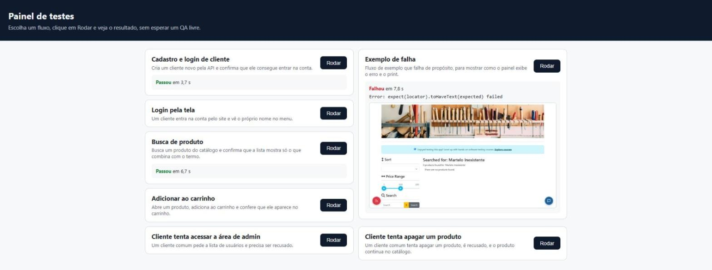

# Painel de testes sob demanda

[English version](README.en.md)



*No print, o fluxo "Exemplo de falha" foi criado só para a foto e falha de propósito. Ele não faz parte da lista de fluxos.*

Um painel em que qualquer pessoa do time escolhe um fluxo de negócio, clica em Rodar e vê o resultado na hora, sem precisar saber programar e sem esperar um QA livre.

## Por que ele existe

Num projeto anterior, analistas de negócio e o time de suporte precisavam ver fluxos funcionando o tempo todo, como o credenciamento de um cliente. Sempre que queriam isso, dependiam de um QA disponível, e o QA quase sempre estava no meio de outra tarefa. Criei um painel em que eles mesmos escolhiam o fluxo, a automação rodava e devolvia o resultado. Este é o mesmo conceito, refeito do zero em cima da loja de demonstração.

A ideia por trás é que automação não precisa servir só ao QA. Quando qualquer pessoa consegue rodar um fluxo crítico sozinha, o QA sai do caminho e o time ganha autonomia.

## Como rodar

```bash
npm ci
npx playwright install chromium
npm run panel
```

Depois abra http://localhost:4321 no navegador.

## O que aparece na tela

Cada fluxo tem um nome de negócio, uma frase do que ele confere e um botão Rodar. Enquanto roda, a tela mostra "Rodando…". No fim mostra se passou ou falhou, quanto tempo levou e, quando falha, a mensagem de erro e o print do momento da falha.

## Como adicionar um fluxo

Cada fluxo aponta para um teste que já existe na suíte. Para adicionar um, inclua uma entrada em [flows.json](flows.json) com um id, o nome que o time vai ver, uma descrição curta, o arquivo do teste, o projeto do Playwright e o título exato do teste.

## Decisões de segurança

O painel só aceita acesso do próprio computador, porque não foi feito para ficar exposto numa rede.

Ele só roda os fluxos da lista. Ninguém consegue digitar um comando ou um filtro de teste pela tela.

Roda um fluxo por vez. Se alguém clicar enquanto outro fluxo roda, recebe um aviso para esperar.

O print da falha só é mostrado se estiver dentro da pasta de resultados dos testes.

## Testes do próprio painel

O painel também tem testes, que rodam com `npm run panel:test`. Eles cobrem a leitura do resultado do Playwright, a lista de fluxos, o fluxo desconhecido, o pedido duplicado, o tempo esgotado e a proteção do print.
